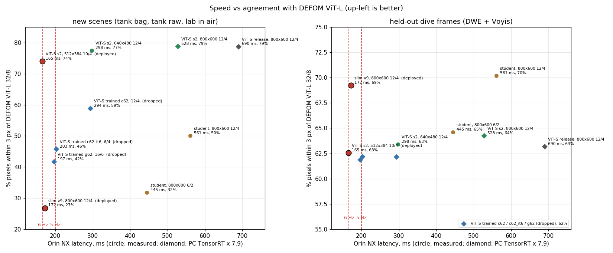
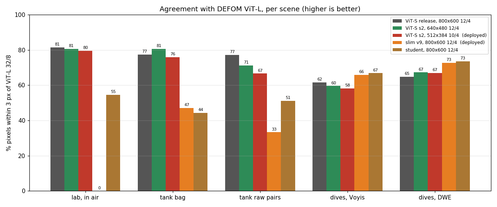

# DEFOM-Stereo on BeeX: results and analysis

Every model we built and tested for live stereo depth on the SVC, what we measured, and why the
two deployed models are built the way they are. For the commands, see
[../README.md](../README.md). Last updated 2026-10-30.

**Goal:** live depth from the DWE stereo cameras on the SVC (Jetson Orin NX), 5-6 Hz, delivered
at 1600x1200, for inspection within 1.5 m.

**Accuracy** in this document = % of pixels within 3 px of **DEFOM ViT-L Middlebury at 32/8**
(the teacher), not ground truth. Two test sets:
- **dives:** held-out frames from the end of each training session (the same sites as training);
- **new scenes:** places never trained on: tank bag, raw tank pairs and the lab in air
  (`1_datasets/probe/`).

**Contents**
1. [Summary: the two deployed models](#1-summary-the-two-deployed-models)
2. [Setup](#2-setup)
3. [Every model tested](#3-every-model-tested)
4. [How we got here](#4-how-we-got-here)
5. [Slim v9](#5-slim-v9)
6. [ViT-S s2](#6-vit-s-s2)
7. [The MobileViT encoder student](#7-the-mobilevit-encoder-student)
8. [Validation and model selection](#8-validation-and-model-selection)
9. [Pitfalls](#9-pitfalls)
10. [Limitations and next steps](#10-limitations-and-next-steps)

---

## 1. Summary: the two deployed models

| | **slim v9** (`1_slim_model`) | **ViT-S s2** (`2_fast_vits_model`) |
|---|---|---|
| inference size, iterations | 800x600, 12/4 | 512x384, 10/4 |
| Orin NX engine, TensorRT fp16b (measured) | 172 ms, 5.8 Hz | 165 ms, 6.05 Hz |
| `defom_svc` end to end | ~5.6-5.8 Hz | 5.8 Hz (2026-10-30) |
| accuracy, dives (DWE / Voyis) | **73% / 66%** | 67% / 58% |
| accuracy, new scenes (tank bag / tank raw / lab) | 47% / 33% / **0%** | **76% / 67% / 80%** |
| what it is | slim stereo core + 0.75x MobileViT encoder, distilled from ViT-L on our 11k dive frames | DEFOM's ViT-S release, unchanged weights; fnet/cnet start at 1/2 resolution |
| strength | best on dive sites like the training data; full 800x600 detail | holds up on unfamiliar scenes |
| risk | fails on new scenes: it learned matching from our dives alone | thin objects: a 5 mm cable at 1 m is ~1.5 px wide at 512 (~2.4 px at 800) |

**Next:** add public stereo datasets to the training data (`slim_v9_2_finetune.yaml`,
`vits_s2_finetune.yaml`), and always check new scenes, not just dives.



---

## 2. Setup

| | |
|---|---|
| PC | RTX 4070: export, evaluation, model comparison on rosbags, some training |
| Thor | long training runs |
| SVC | Orin NX 16 GB, JetPack 6.0, TensorRT 8.6.2: `defom_svc` |
| AIB | ROS Melodic (Python 2.7): `defom_receiver.py` |
| cameras | 2x DWE stellarHD, raw MJPEG 1600x1200 @ 60 fps, baseline 0.1 m, `e3d1008.dwecal` (water calibration) |
| DWE's own depth | `refined_pro`, 6-7 Hz at 800x600 (not ground truth) |

---

## 3. Every model tested

Orin NX, TensorRT fp16b. **m** = measured on the Orin; **e** = estimated as PC TensorRT x 7.9
(the factor measured on the student: 561 ms on the Orin vs 71 ms on the PC). Accuracy is from
the 2026-10-29 benchmark: 40 frames per set, every model at 800 wide.

| model | size, iters | Orin NX | new scenes | dives | status |
|---|---|---|---|---|---|
| DEFOM ViT-L Middlebury (teacher) | 800x600, 32/8 | too slow | reference | reference | quality reference |
| DEFOM ViT-S release | 800x600, 32/8 | too slow | 86% | 65% | |
| DEFOM ViT-S release | 800x600, 12/4 | 690 ms e | 79% | 63% | too slow |
| **ViT-S s2** | **512x384, 10/4** | **165 ms m** | **74%** | **63%** | **deployed** |
| ViT-S s2 | 512x384, 12/4 | 186 ms e | 74% | 63% | |
| ViT-S s2 | 640x480, 12/4 | 298 ms m | 77% | 63% | step up for thin objects |
| ViT-S s2 | 800x600, 12/4 | 528 ms e | 79% | 64% | |
| **slim v9** | **800x600, 12/4** | **172 ms m** | **27%** | **69%** | **deployed** |
| MobileViT student | 800x600, 12/4 | 561 ms m | 50% | 70% | too slow |
| MobileViT student | 800x600, 6/2 | 445 ms m | 32% | 65% | fails at close range |
| ViT-S trained `c62` (small fnet/cnet, ViT x0.625) | 800x600, 12/4 | 294 ms e | 59% | 62% | dropped |
| ViT-S trained `c62_it6` (GRU fine-tuned for 6/4) | 800x600, 6/4 | 203 ms e | 46% | 62% | dropped |
| ViT-S trained `g62` (GRU 64x2) | 800x600, 16/6 | 197 ms e | 42% | 62% | dropped |
| ViT-S trained `f62` (all new, trained together) | 800x600, 12/4 | ~172 ms e | 17% | 59% | dropped |

Per scene:



Side by side, per scene (left | ViT-L | each model, with |error| maps below):
[tank bag](figures/panels_tank_bag.jpg), [tank raw pairs](figures/panels_tank_raw_pairs.jpg),
[lab in air](figures/panels_lab_in_air.jpg), [DWE dives](figures/panels_dives_DWE.jpg),
[Voyis dives](figures/panels_dives_Voyis.jpg). Where the time goes in DEFOM:
[speed study](figures/speed_study.png).

---

## 4. How we got here

| # | stage | outcome |
|---|---|---|
| 1 | **MobileViT student**: DEFOM's 1530 MB ViT-L encoder replaced by a 27 MB student that copies its outputs; the stereo core kept | 76.8% vs 71.2% for the first student ([section 7](#7-the-mobilevit-encoder-student)) |
| 2 | PC ROS node (`defom_stereo_pointcloud`, LibTorch) | ~120 ms per frame on the 4070, matches Python |
| 3 | TensorRT on the Orin: ONNX exported on the PC, engine built on the Orin; layers that overflow fp16 stay fp32 (`fp16b`) | student 800x600: 24/8 1208 ms, 12/4 538 ms (1.9 Hz) |
| 4 | Speed without a new model | fewer iterations: 16/6 is free, 12/4 costs 1.7 points. Warm start: worse. 1600x1200 inference: unstable and 5-7 s per frame |
| 5 | **Slim v9**: slim stereo core | 172 ms (5.8 Hz), 69% on held-out dives ([section 5](#5-slim-v9)) |
| 6 | SVC service + AIB receiver (`6_deploy/defom_svc/`) | 5.6 Hz end to end; C++ output equals PyTorch, UDP bit-exact; the raw stream needs the `.dwecal` maps |
| 7 | Slim v9 in the lab | depth ~4x too close, order wrong; shift test 186 px instead of 30 in air. Its matcher learned only our dives |
| 8 | Student deployed meanwhile | 12/4 1.8 Hz, 6/2 2.25 Hz |
| 9 | Tank test (2026-10-28) | all models live, 0 errors. Offline, DEFOM's own ViT-S release at 12/4 was within 0.3% of ViT-L, our student 1.7% |
| 10 | ViT-S at 5-6 Hz (2026-10-28/29) | every attempt to shrink or retrain its GRU lost the tank and the lab; the release with 1/2-resolution fnet/cnet and unchanged weights became **ViT-S s2** ([section 6](#6-vit-s-s2)) |
| 11 | ViT-S s2 on the vehicle (2026-10-30) | 165 ms engine, 5.8 Hz in `defom_svc`. The AIB dropped to ~5 Hz until `rmem_max` was raised |
| 12 | Cleanup (2026-10-30) | the repo holds only the two models; bag comparison tools in `7_ros_tools/` |

---

## 5. Slim v9

**Why DEFOM is slow on the Orin NX.**
- The student at 800x600, 12/4 iterations, takes 538-561 ms (TensorRT fp16b).
- One refinement iteration costs ~8 ms.
- Most of the rest is DEFOM's fnet and cnet, not the encoder. They start with a 7x7 conv and two
  64-channel residual blocks at **full input resolution**, and fnet runs them on both images.

**v9** (`slim_stereo.py` preset `v9`):
- fnet/cnet with a stride-2 stem and slim widths (32/48/64);
- the encoder student at 0.75x input;
- GRU hidden 64 with 2 levels.

Stereo core 4.3 M parameters (DEFOM's: 16.7 M), **172 ms (5.8 Hz)** at 800x600, 12/4.

The slim core cannot reuse DEFOM's weights, so it was distilled in three steps:
1. The student was re-distilled at its 0.75x input. It lives on inside `1_slim_model`, and
   `slim_v9_1_from_vitl.yaml` reuses it.
2. The slim core was trained on the teacher's disparity at every iteration (L1, later iterations
   weighted more), with the student frozen: best epoch 38, 68.7%.
3. Both were fine-tuned together: `slim_v9_joint` epoch 2, deployed as `1_slim_model`.

`SlimDEFOM` configured with DEFOM's own sizes and weights reproduces DEFOMStereo exactly
(`python3 distillation/slim_stereo.py`).

**On held-out dives** it matches the full student (73% on DWE dives) at 3x the speed; most of
the remaining gap is far, textureless water. **On new scenes it fails:** 33-47% in the tank,
0% in the lab. The slim core learned matching from our dives' disparity alone, so it fits those
dives and little else.

---

## 6. ViT-S s2

DEFOM's own ViT-S release (`defomstereo_vits_rvc.pth`) was trained by its authors on ~17
datasets. It generalises far better than anything trained on our dives: in the tank and in air
it stays close to ViT-L, where the student and slim v9 fail. As released it runs at ~1.4 Hz on
the Orin NX at 800x600, mostly because of the ViT and the full-resolution fnet/cnet (~545 ms);
12 GRU iterations take ~185 ms.

**`vits_s2`** keeps every weight of the release. Only fnet/cnet start at 1/2 resolution, with
stem strides (2,1,2,1) instead of (1,1,2,2). Every tensor keeps its shape, so the release loads
unchanged (`slim_stereo.py --make vits_s2`). On its own this change costs nothing in quality:
78.8% vs 78.7%. The rest of the speed comes from inferring at 512x384 with 10/4 iterations:

| size, iterations | Orin NX | new scenes |
|---|---|---|
| **512x384, 10/4** | **165 ms (6.05 Hz)** | **74%** |
| 640x480, 12/4 | 298 ms (3.4 Hz) | 77% |
| 800x600, 12/4 | ~528 ms est. | 79% |

Close range needs refinement iterations: the release in the tank scores 77% at 12/4 but 54% at
6/3.

**What failed:** making the release faster by training ([section 3](#3-every-model-tested),
the four "trained" rows).
- What was tried: a smaller GRU (64x2) distilled step by step, a smaller ViT input, and
  DEFOM's own GRU retrained for fewer iterations.
- What happened: each lost the tank and the lab (42-46% at ~5 Hz), the same way slim v9 did.
- The 30 px shift test alone did not catch this: `f62` passed it. Probe sets of new scenes are
  needed.

**Fine-tuning** (`train_vits.py`) therefore keeps the model's internal outputs (matching
features, GRU states and context) anchored to the frozen release. L1 to ViT-L's labels pulls it
towards the teacher. By default only fnet/cnet train.

**fp16:** ViT-S amplifies fp16 rounding on murky frames: up to ~1 px median from fp32 on frame
001412 ([figure](figures/fp16_murky_frame.jpg)). PyTorch's own fp16 does the same, and against
ViT-L it is no less accurate (73.2% vs 73.3%). The Orin check therefore accepts an engine that
is as close to fp32 as PyTorch's fp16 ([README 6.1](../README.md#61-build-and-check-the-engine)).

---

## 7. The MobileViT encoder student

The first model: a full DEFOM with its 1.5 GB encoder replaced. It is now slim v9's encoder.
Its training script has been retired; the trained student is reused.

**What is distilled.** DEFOM-Stereo is a DepthAnythingV2 (DINOv2-L) encoder that gives
monocular depth features, plus a stereo core (feature/context nets, correlation, GRU updates).

```
DINOv2-L backbone   1217.5 MB   ┐
depth_head           123.8 MB   ├─ REPLACED by a 27 MB MobileViT student
depth_feat           122.5 MB   ┘
fnet / cnet / GRU     66.8 MB   ── KEPT, unchanged, from defomstereo_vitl_middlebury.pth
total               1530.5 MB   →  ~94 MB
```

The student only reproduces the encoder's **outputs**: three `d_features` maps, the left/right
matching features and an inverse-depth prior. So it never learns stereo matching itself, and
the frozen teacher's outputs on unlabelled footage are the targets.

**Design choices, each measured:**
- **Backbone:** MobileViT-S (`mobilevit.py`) tapped at /4, /8, /16, then a light FPN with a head
  per output. It was warm-started from the DINOv3→MobileViT distillation (304/304 tensors).
- **Input divisible by 32:** MobileViT unfolds 2x2 patches on the /16 map. /16 crashed at
  1064x1400 and at 336x448.
- **Output calibration:** the teacher's outputs reach ~2x10⁷. A fresh head emits O(1) values,
  so that term never trained (0.001% movement in 8 epochs). The teacher's output statistics
  are measured first, and the heads predict standardised values. With that, the same 8 epochs
  moved those terms 19-81%.
- **Normalisation:** BatchNorm at batch 2-4 made train and eval differ by 19-45%. So the FPN
  uses GroupNorm, and MobileViT's BatchNorm statistics are re-estimated, then frozen (the gap
  is exactly 0).
- **Loss:** squared error per feature map divided by the teacher's own energy (relative MSE).
  Without it, the matching-feature term (~10¹¹) drowns every other term (~10⁶). The depth
  prior is matched raw with L1.
- **Resolution-agnostic training:** each eye is resized to a random long side of 512-1024 and
  both take the same crop. A fixed 800x600 resize squashed 1:1 Voyis frames and tied the
  student to one scale (feature error 0.11 at 800x600, 0.30-0.47 at other sizes).
- **Balanced sampling:** each camera gets an equal share of an epoch, with no frame drawn more
  than 4x.
- **Numerics:**
  - The teacher's matching features overflow fp16 at the first stereo-core conv, which turned
    the disparity into NaN. That conv now always runs in fp32.
  - A bf16 teacher (272 vs 456 ms) and TF32 are as accurate as fp32.

**Results** (`evaluate.py`, 80 Voyis + 80 DWE held-out frames, long sides 512 and 640):

| model | within 3 px, overall (95% CI) | vs the first student | Voyis @512 / @640 | DWE @512 / @640 |
|---|---|---|---|---|
| **multi-scale epoch 20** (selected) | **76.8%** (74.1-79.4) | **+5.6** (+4.1 to +7.1) | 75.2% / 71.0% | 82.9% / 78.1% |
| multi-scale epoch 0 | 75.7% (73.0-78.2) | +4.5 | 74.5% / 70.2% | 80.4% / 77.7% |
| first student (fixed 800x600) | 71.2% (68.7-73.5) | reference | 69.3% / 65.9% | 75.6% / 73.9% |

What this showed:
- **Gains come early:** almost all of the gain came in the first epoch, so fine-tunes need
  ~10 epochs.
- **Disagreement is in open water:** on Voyis, 93-94% agreement on textured pixels against
  49-57% on textureless ones.
- **Close range was fixed:** error dropped from 36% to 1.1-1.6% where disparity exceeds 30% of
  the image width.

---

## 8. Validation and model selection

- **Measure disparity, not the training loss.** Validation runs the whole model on held-out
  frames and compares its disparity with the teacher's. The score is the share of pixels
  within 3 px, averaged over cameras.
- **Temporal split.** The last 5% of each session is held out. Consecutive frames are
  near-duplicates, so a random split leaks them into validation.
- **Enough frames.** 24 frames per camera was too noisy (one hard frame moves a line by ~4%);
  80 keeps the noise at ~1-2%.
- **Best checkpoint.** Improvements are saved as `student_best.pth` + `best.json`. A
  fine-tune scores its starting model first, so it can only get better. Scores are compared
  only on the same frames and iterations (`best.json` stores a signature).
- **New scenes.** Held-out frames come from the training sites, so they missed slim v9's
  failure. ViT-S training also validates on the probe sets and a shift test; for slim, use
  `evaluate.py --image_dir 1_datasets/probe/<set> --frames all`.
- **`evaluate.py`** answers the same question offline: bootstrap 95% confidence intervals, a
  paired comparison against a reference model, and error by texture and distance.
- **Fine-tune vs resume.** `init_from` starts a new run with a fresh schedule; use it after
  adding data. `resume_from` restores the optimizer and schedule; use it only to finish an
  interrupted run.

---

## 9. Pitfalls

- **Test on new scenes**, not only held-out frames of the training sessions. The shift test
  alone is not enough.
- **Don't retrain DEFOM's GRU on our dives alone:** it loses generality. Anchor to the release,
  or add broad data.
- **Run DEFOM teachers in fp32 when training:** `fnet.convd` reaches ~1e5 and overflows fp16
  (inf/NaN).
- **Always copy the ONNX `.json` with the model:** an engine built without it runs but is wrong.
- **TensorRT runtimes must register plugins** (`initLibNvInferPlugins`): InstanceNorm is a
  plugin.
- **One engine build at a time on the Orin.** "Tactic device request ... insufficient memory"
  warnings are harmless.
- **DWE's `rtpsender` holds the cameras:** `sudo systemctl stop rtpsender` before `defom_svc`.
  `fuser` needs `sudo` to see root processes.
- **Raise the AIB's UDP receive buffer once** (`net.core.rmem_max`), or frames drop.
- **The `.dwecal` is a water calibration:** rectification can only be judged underwater.
- **`rostopic pub` values:** write them as `"data: '...'"`. A bare `6` is read as a number and
  `off` as false.
- **ROS tests on the PC:** use a private master (`roscore -p 11411`), never the default 11311
  of a running session.

---

## 10. Limitations and next steps

- **Generalisation is the open problem.** Anything trained on our dives alone fits them and
  fails on new scenes. Adding public stereo datasets is the next step, for slim v9 and for a
  ViT-S fine-tune. Always validate on the probe sets.
- **Thin objects at 512x384** are under-resolved, and the benchmark does not measure them on
  their own. 640x480 (3.4 Hz) is the step up.
- **The metric is agreement with the teacher**, not ground truth. An absolute check needs a
  tank rig with known geometry: a flat plate at 0.5-1.5 m, 3/5/10 mm cables, holes, a step.
- **Open water dominates the remaining gap**, and stereo is ill-posed there for any model.
- **Raw 1600x1200 frames are not rectified:** apply the `.dwecal` maps before using them as
  training data.
- **1600x1200 inference** is out of reach on the Orin NX; `defom_svc` upsamples the disparity
  instead.
- **Bandwidth:** `defom_svc` sends depth at 1600x1200 (~8 MB per frame). Sending it at the
  engine's size and upsampling on the AIB would cut ~110 ms of latency.
